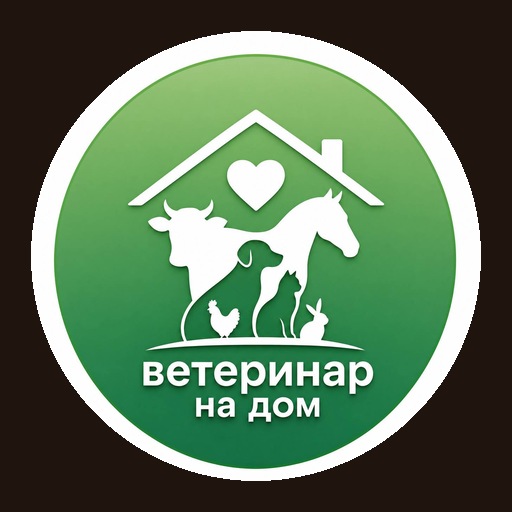

<p align="center">
  
</p>

<h1 align="center">🩺 ВетДом · Ветеринары · Веб-кабинет для компьютера</h1>

**Веб-кабинет для врачей** платформы **ВетДом** («ветеринар на дом»), открывается в браузере компьютера. Мобильное приложение для врачей собирается из этого же кода — репозиторий [VetWeb-Veterinar-mobile](https://github.com/arondrotsild-lab/VetWeb-Veterinar-mobile).

## Экосистема ВетДом — 6 приложений

| № | Приложение | Для кого | Репозиторий | Что внутри |
|---|---|---|---|---|
| 1 | 🌐 **Клиенты · Веб-версия для компьютера** | владельцы питомцев | [VETWEB](https://github.com/arondrotsild-lab/VETWEB) | вызов врача, карта, ветпаспорт, магазин + **общий сервер и база данных** |
| 2 | 📱 **Клиенты · Мобильное приложение** | владельцы питомцев | [VETWEB-mobile](https://github.com/arondrotsild-lab/VETWEB-mobile) | iPhone / Android / RuStore, собирается из кода №1 |
| 3 | 🩺 **Ветеринары · Веб-кабинет для компьютера** | врачи | **VetWeb-Veterinar** ← вы здесь | заказы, доход, KPI-уровни, лига, профиль |
| 4 | 📲 **Ветеринары · Мобильное приложение** | врачи | [VetWeb-Veterinar-mobile](https://github.com/arondrotsild-lab/VetWeb-Veterinar-mobile) | iPhone / Android / RuStore, собирается из кода №3 |
| 5 | 📊 **Руководитель · CRM — веб-версия для компьютера** | владелец и инвесторы | [VetWebCRM](https://github.com/arondrotsild-lab/VetWebCRM) | выручка и прибыль, финансы и счета, юнит-экономика, маркетинг, заказы, клиенты и питомцы, врачи, магазин |
| 6 | 💼 **Руководитель · CRM — мобильное приложение** | владелец и инвесторы | [VetWebCRM-mobile](https://github.com/arondrotsild-lab/VetWebCRM-mobile) | iPhone / Android, собирается из кода №5 |

Все приложения работают с **одним сервером и одной базой данных** (репозиторий VETWEB): заказ клиента сразу виден врачу и в CRM. Языки: русский, English, Türkçe, العربية (в CRM переключатель языка уже есть, перевод текстов CRM — в работе).

## Что умеет кабинет

| Раздел | Что внутри |
|---|---|
| **Главная** | Статус «На линии / Не на линии», цель дня, заработок за сегодня, текущий заказ с кнопками этапов, новые заказы рядом |
| **Новый заказ** | Всплывающее окно со звуком и таймером 30 секунд: сколько врач получит, адрес, питомец, жалоба |
| **Заказы** | Новые · В работе · История по дням с доходом |
| **Карточка заказа** | Этапы визита (принят → в пути → на месте → приём → готово), медкарта питомца, прошлые визиты, оценка ИИ, звонок клиенту, маршрут, заключение после приёма |
| **Доход и расходы** | Баланс и вывод на карту, заработано / потрачено / чистыми, график по дням, расходы по категориям, все операции |
| **Мой уровень и KPI** | Бронза 55% → Серебро 60% → Золото 65% → Платина 70%, шкала прогресса, условия перехода, показатели, цели дня и недели, достижения |
| **Лига ветеринаров** | Рейтинг врачей за 30 дней: общий зачёт, визиты, оценки, возвращаемость, скорость; призы топ-3 |
| **Новости** | Платформа, наука, мир ветеринарии, обучение |
| **Профиль** | Анкета врача, редактирование, отзывы клиентов |

## Запуск на Mac

```bash
./dev-local.sh
```

Кабинет откроется на **http://localhost:5174**. Если общий сервер ВетДом ещё не запущен, скрипт запустит его сам.

**Быстрый вход:** кнопка «Войти как Анна Соколова» на странице входа
(телефон `+79990000101`, пароль `vetdemo1234`).

## Как показать связку «клиент → врач»

1. Откройте кабинет врача и нажмите **«Выйти на линию»**.
2. На сайте для клиентов (http://localhost:5173) оформите вызов врача.
3. Через несколько секунд у врача прозвучит сигнал и появится новый заказ → **«Принять»**.
4. Клиент видит, что врач принял заказ и едет; врач ведёт заказ по этапам до «Завершить приём».

Для быстрого показа без клиента есть кнопка **«✨ Тестовый заказ»** на главной.

## Стек

React 18 · TypeScript · Vite · Tailwind CSS · общий API (Express + PostgreSQL).
